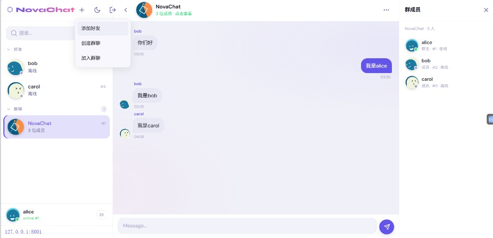

# NovaChat

C++ 集群即时通讯演示：**自研 RPC + ZooKeeper 服务发现 + Redis 跨机推送 + MySQL 消息持久化**。

Web 端群聊示意：



## 架构分工

```text
Browser / NovaClient
        │  HTTP :8088  +  WebSocket :8089
        │  （双机演示另开 :8188 / :8189）
        ▼
   NovaGateway ─────────────────────────────┐
   · 长连接、登录、好友/群、私聊/群聊        │
   · 在线：本机直推 / Redis Pub/Sub          │
   · 离线与历史：MySQL message 表            │
        │                                   │
        │ 自研 RPC（NRPC 帧 + request_id）   │
        │ ZK 发现 UserServiceRpc 实例        │
        ▼                                   │
   UserService (:8001)                      │
   · 仅 GetUserProfile（昵称/头像/状态）     │
   · 查 MySQL user 表                       │
                                            │
   ZooKeeper (:2181)  ← 服务注册/发现 ──────┘
   Redis     (:6379)  ← 跨 Gateway 推消息、Presence
   MySQL              ← 账号 / 好友 / 群 / 消息
```

| 组件 | 做什么 | 不做什么 |
|------|--------|----------|
| **ZooKeeper** | 登记 `UserServiceRpc` 实例临时节点，供 Gateway 发现 `ip:port` | 不传聊天消息；不按方法建节点 |
| **自研 RPC** | ChatServer→UserService 查用户资料；TCP 长连接 + `request_id` 多路复用 | 不承载私聊/群聊正文 |
| **Redis Pub/Sub** | 用户在线时跨 Gateway 推私聊/群聊/上下线 presence | 不做消息持久化 |
| **MySQL** | 账号、好友、群成员；消息先落库；离线 `status=0`，ACK 后已读 | — |
| **Gateway** | 对客户端的唯一业务入口；多实例靠 Redis 互通 | — |

### ZooKeeper 节点

```text
/NovaChat-service/UserServiceRpc/127.0.0.1-8001   # 临时节点，data = 127.0.0.1:8001
```

- 上层目录为**永久**节点；实例为 **`ZOO_EPHEMERAL`**，进程退出自动删除。
- 发现只到**服务级**；方法名 `GetUserProfile` 放在 RPC 请求头，由 UserService 进程内分发。
- 多实例时 `GetChildren` 返回多个节点，**选哪个由客户端决定**（当前取第一个）。

### RPC 协议要点

- 帧格式：`NRPC` magic + version + 网络序 header 长度 + `RpcHeader` + body。
- Header 含 `service_name` / `methode_name` / `request_id` / `errcode`；心跳 ping/ack；调用超时与连接失败区分。
- 登录时 Gateway 对本人及每位好友调用 **`GetUserProfile`**（好友关系仍本地查库）。

### 消息路径

1. 客户端发私聊/群聊 → Gateway **先写 MySQL**。
2. 对端在线：本机 WebSocket 直推，或 **Redis PUBLISH** 到对端 userid 频道。
3. 对端离线：库中 `status=0`；上线后在 `LOGIN_ACK` 带未读，客户端 **ACK** → `status=1`。
4. 刷新后：私聊 `LOAD_HISTORY`、群聊 `LOAD_GROUP_HISTORY` 从 MySQL 拉取。

## 启动

依赖：MySQL / Redis / ZooKeeper（可用 Docker：`novachat-mysql`、`novachat-redis6379`、`novachat-zk`）。

```bash
bash scripts/build.sh
bash scripts/run_all.sh    # 单 Gateway：8088 / 8089
# 或双机模拟跨 Gateway：
bash scripts/run_dual.sh   # gw-1:8088  +  gw-2:8188
```

| 入口 | 地址 |
|------|------|
| Web（gw-1） | http://127.0.0.1:8088/ |
| Web（gw-2） | http://127.0.0.1:8188/ |
| UserService RPC | `127.0.0.1:8001`（ZK 可见） |
| 终端客户端 | `./bin/NovaClient 127.0.0.1 6666` |

种子账号：`1 / 2 / 3` = alice / bob / carol，密码 `123456`。

跨机演示：一窗口打开 `:8088` 登 alice，另一窗口 `:8188` 登 bob，互发即走 Redis。

## 功能一览

- 私聊 / 群聊（建群、加群、退群、群成员面板）
- 加好友 / 删好友
- 在线状态广播（presence）
- 离线消息 + 历史拉取
- Web UI：默认**白天模式**；侧栏折叠；「+」菜单添加好友/建群/加群

## 目录

```text
rpc/                 # 自研 RPC（帧、长连接、ZK 客户端）
services/user/       # UserService：GetUserProfile
gateway/             # NovaGateway：业务 + Web + RPC 调用方
client/              # NovaClient
web/                 # 前端
proto/user.proto     # UserServiceRpc
conf/gateway.conf    # gw-1
conf/gateway2.conf   # gw-2（双机）
conf/user.conf       # UserService
scripts/run_dual.sh  # 双 Gateway 启动
docs/DATAFLOW.md     # 数据流说明
docs/images/         # README 配图
```

## 说明

- 聊天正文**不走 RPC**，只走 Gateway 长连接 + Redis + MySQL。
- Presence 独立 RPC 服务已移除；在线状态以 MySQL `user.state` + Redis 推送为准。
- 个人简历、PDF 等已在 `.gitignore` 中排除，不会进入仓库。
