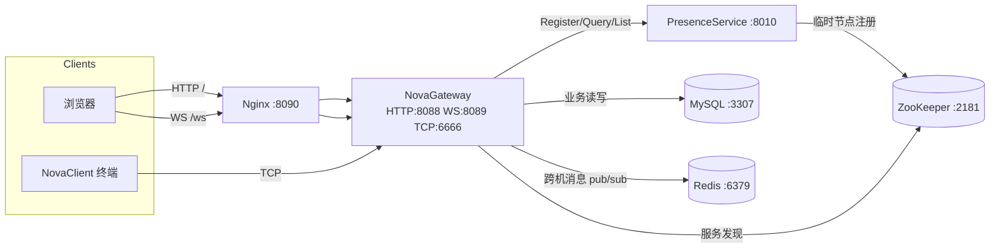

# NovaChat 数据流向框架

> 一句话：浏览器 / 终端客户端经 **Nginx** 或直连进入 **NovaGateway**；聊天业务落 **MySQL + Redis**；在线路由走自研 **RPC + ZooKeeper** 的 **PresenceService**。

## 组件与端口

| 组件 | 端口 | 职责 |
|------|------|------|
| Nginx | **8090** | 统一入口：`/` → HTTP:8088，`/ws` → WS:8089 |
| NovaGateway | 8088 / 8089 / 6666 | HTTP 静态页、WebSocket、TCP 终端长连接；本地 ChatService |
| PresenceService | 8010 | 在线注册 / 查询 / 列表（Protobuf RPC） |
| ZooKeeper | 2181 | RPC 服务注册发现：`/NovaChat-service/<Service>/<ip:port>` |
| MySQL | 3307→3306 | user / friend / group / offline 持久化 |
| Redis | 6379 | 跨连接 / 跨机消息转发与订阅 |

## 总览（Mermaid）



## 关键数据流

### 1. 登录（浏览器经 Nginx）

```
Browser → Nginx:8090/ → Gateway:8088 (静态页)
Browser → Nginx:8090/ws → Gateway:8089 (WebSocket 握手)
Browser 发 login JSON
  → Gateway ChatService 查 MySQL 校验
  → RPC Presence.Register(user, gateway_id)   // 经 ZK 发现 127.0.0.1:8010
  → RPC Presence.Query(friends) 补齐好友在线态
  → 回 ACK（含 friends / groups / gateway_id）
```

### 2. 私聊推送

```
A 在线发消息 → Gateway 本机找 B 的 TcpConnection
  ├─ 同机在线：直接 WS/TCP 推送
  └─ 跨机 / 本机无连接：Redis publish → 对端 Gateway subscribe → 推送
离线：写入 MySQL offlinemessage，下次登录拉取
```

### 3. Presence 控制面（不走聊天消息路径）

```
PresenceService 启动
  → 连 ZK → 创建临时节点 /NovaChat-service/PresenceServiceRpc/ip:port

Gateway 每次 RPC CallMethod
  → ZK GetChildren → 解析 ip:port → 短连接调用
  → 失败则回退 conf 的 rpcserverip/port
```

### 4. 角色边界（面试口径）

| 路径 | 技术 | 为什么 |
|------|------|--------|
| 聊天业务默认本地 | Gateway 内 Model + MySQL | 避免 User/Friend/Message 拆成空微服务 |
| 长连接 | muduo TCP / 自研 WS | 在线推送 |
| 跨机消息 | Redis | 解耦多 Gateway |
| 在线路由 | 自研 RPC + ZK | 确需远程的控制面，顺便练 RPC 框架 |
| 入口 | Nginx | HTTP/WS 反代、统一对外端口 |

## 启动

```bash
bash scripts/build.sh
bash scripts/run_all.sh
# 浏览器访问（远程开发请转发 8090）：http://127.0.0.1:8090/
```
